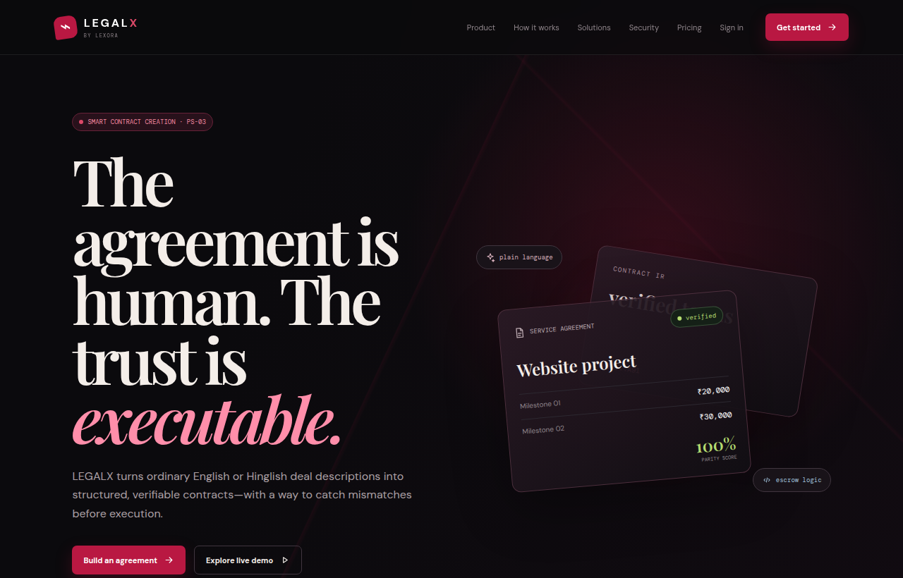
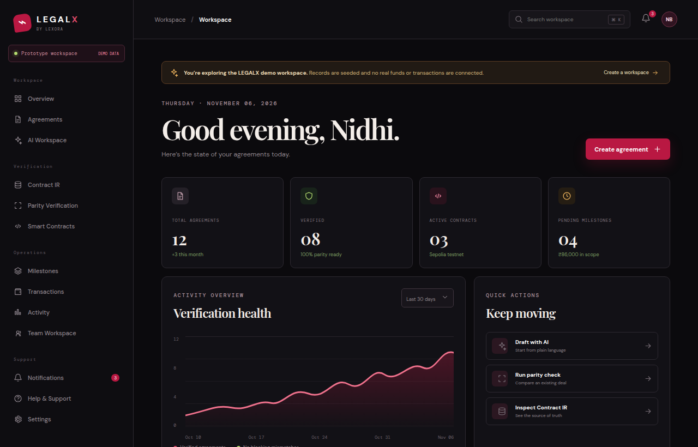
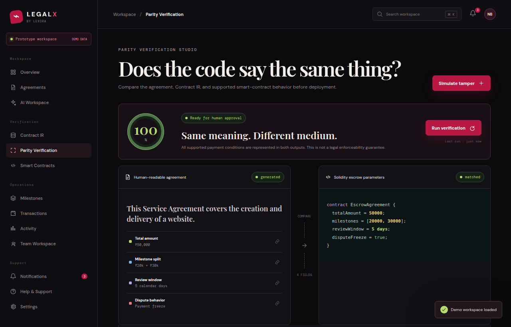
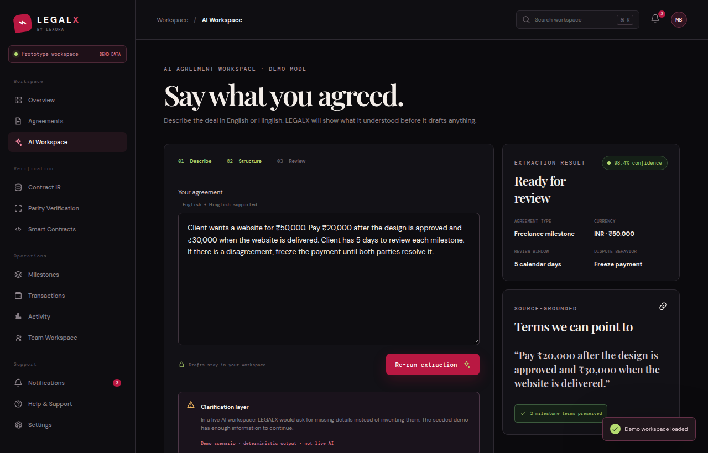
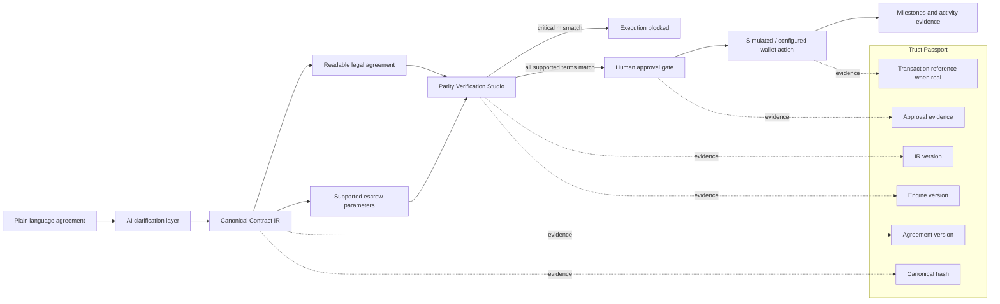
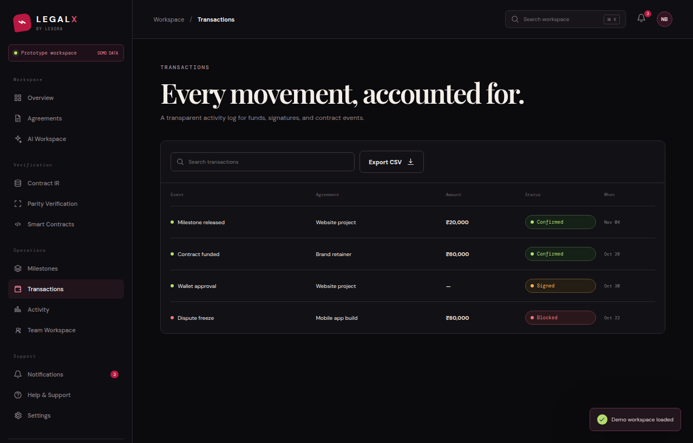
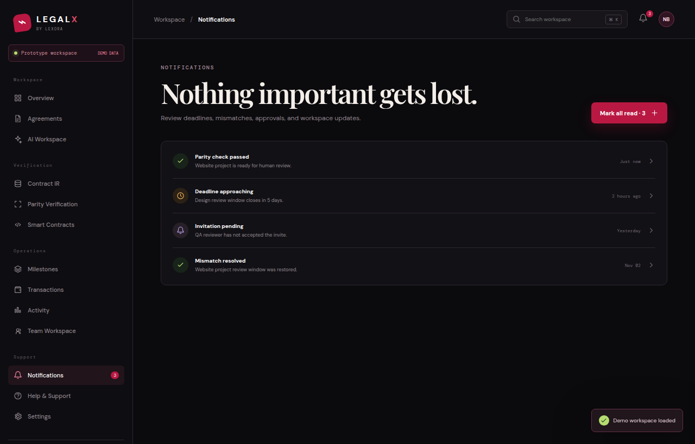
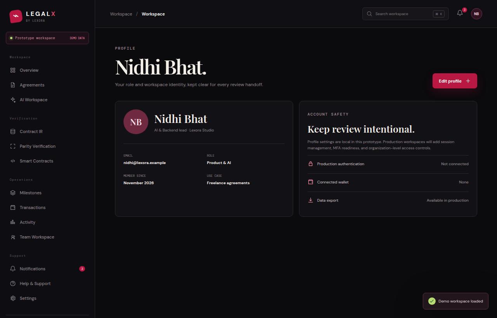
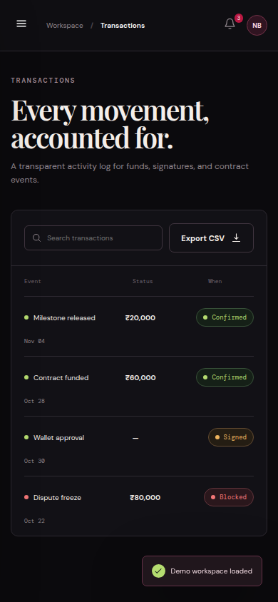
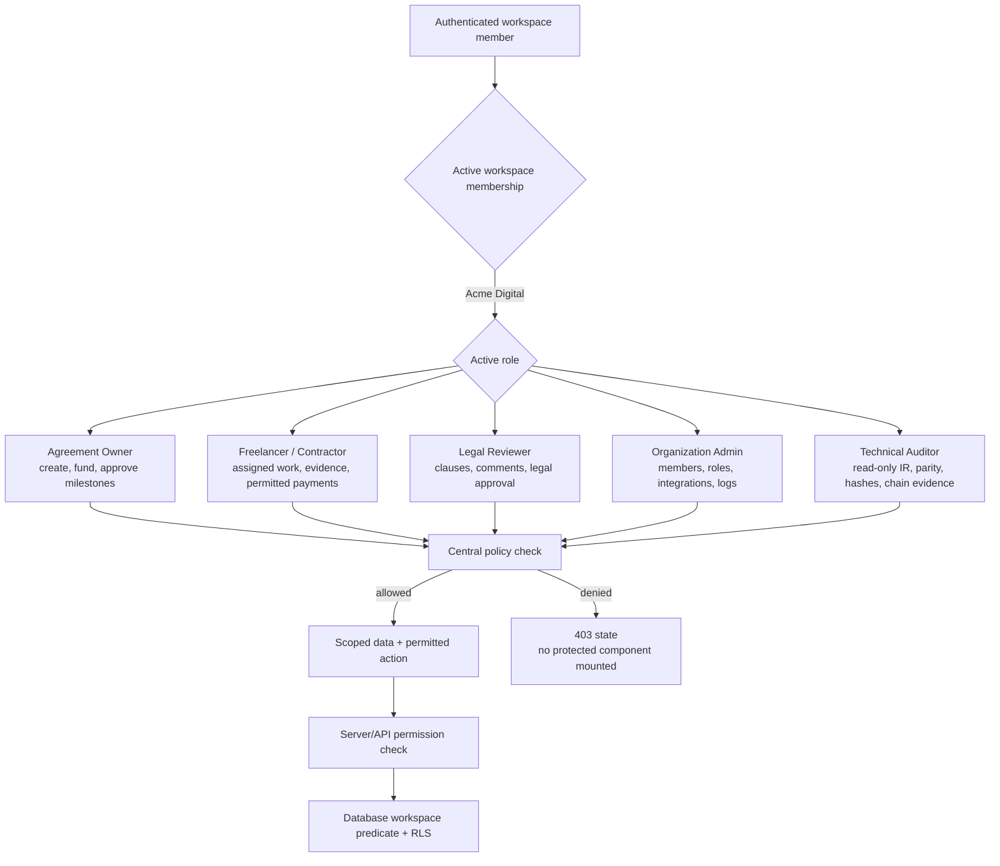

# LEGALX

### From human agreements to executable trust.

LEGALX is Lexora’s startup-grade legal-tech prototype for turning ordinary English or Hinglish deal descriptions into structured contract intelligence, readable agreement output, and a parity check against supported escrow behavior.

> **Important boundary:** LEGALX verifies consistency between representations. It does not guarantee legal correctness, enforceability, or liability outcomes. The current public build labels authentication, AI, storage, wallet, and blockchain as prototype/simulation states where those services are not connected.

## What is implemented

- Dark-only cinematic public website with responsive navigation, product story, use cases, security language, pricing prototype plans, FAQ, contact, privacy, and terms surfaces.
- Guest demo entry at `/demo` without an account or wallet.
- Local demo sign-up, sign-in, onboarding, profile, settings, toasts, breadcrumbs, responsive sidebar, notifications, help center, team workspace, and audit activity.
- Agreement management, guided AI workspace, deterministic seeded extraction, source-grounded clauses, Contract IR structured/JSON views, readable legal agreement preview, version/integrity evidence, and milestone tracking.
- Parity Verification Studio with matching and tampered states. Changing the supported review window from 5 days to 2 days reduces the score to 74 and blocks the execution path; restoring it returns the demo to 100.
- Smart-contract workspace with visibly simulated Sepolia records, no fabricated transaction submission, no private-key handling, and clear next-step guardrails.
- Responsive layout for desktop, tablet, and mobile breakpoints; reduced-motion CSS fallback; optimized generated visual assets in the public hero/trust story.

## Judge walkthrough

1. Open `/demo` or choose **Explore live demo** from the landing page.
2. Choose **AI Workspace** and review the seeded ₹50,000 website agreement.
3. Open **Contract IR** to inspect the structured source of truth and JSON representation.
4. Open **Parity Verification**, choose **Simulate tamper**, and observe the exact blocking mismatch.
5. Choose **Restore matching logic**, then visit Smart Contracts, Milestones, Transactions, and Activity.
6. Open the Website project agreement detail for the lifecycle, document preview, version, and integrity hash evidence.

## Local development

```bash
npm install
npm run dev
npm run build
npm run test
```

The app is a Vite + React + TypeScript frontend. `public/manus-routes.json` declares every page route for the managed runtime.

## Architecture

- `src/App.tsx` — typed UI primitives, route dispatcher, public pages, application shell, demo data, and product workflows.
- `src/styles.css` — dark LEGALX design tokens, responsive layout, accessibility-friendly focusable controls, and mobile breakpoints.
- `public/manus-routes.json` — route manifest used by managed Preview and publication.
- `docs/` — setup, architecture, security, AI, blockchain, data, testing, operations, and demo documentation.
- `scripts/test-demo.mjs` — deterministic parity behavior checks that run without external services.

## Environment and production integrations

Copy `.env.example` only when wiring a real deployment. No secret is required for the guest demo. The documented production path expects Supabase Auth/Database/Storage, server-side Gemini, a Sepolia RPC provider, deployed escrow address/ABI, and a wallet client such as wagmi/viem. Those integrations are intentionally not claimed as active in the current static prototype.

## Honest status

| Area | Current status |
| --- | --- |
| Public frontend | Implemented |
| Guest demo | Implemented, deterministic |
| Local auth/onboarding | Prototype only |
| Gemini | Not connected; deterministic provider shown |
| Supabase | Not connected; integration documented |
| Contract IR | UI schema represented by seeded demo data; production schema integration pending |
| Parity Engine | Deterministic demo engine behavior represented in UI; production engine integration pending |
| Solidity/Sepolia | Simulation UI only; no transaction is claimed |
| File storage | Not connected; production private-storage path documented |
| Tests | Build, TypeScript, deterministic parity checks |

## Documentation

- [Architecture](docs/ARCHITECTURE.md)
- [Setup](docs/SETUP.md)
- [Database and persistence](docs/DATABASE.md)
- [API and validation](docs/API.md)
- [AI pipeline](docs/AI_PIPELINE.md)
- [Blockchain](docs/BLOCKCHAIN.md)
- [Security](docs/SECURITY.md)
- [Testing](docs/TESTING.md)
- [Demo guide](docs/DEMO_GUIDE.md)
- [Deployment](docs/DEPLOYMENT.md)
- [Trust layer](docs/TRUST_LAYER.md)
- [Threat model](docs/THREAT_MODEL.md)
- [Integrity and hashing](docs/INTEGRITY_AND_HASHING.md)
- [Accessibility](docs/ACCESSIBILITY.md)
- [Performance](docs/PERFORMANCE.md)
- [Operations](docs/OPERATIONS.md)
- [Product roadmap](docs/PRODUCT_ROADMAP.md)
- [RBAC and workspace authorization](docs/RBAC.md)
- [Final acceptance audit](docs/FINAL_ACCEPTANCE_AUDIT.md)

## Licensing

No license is asserted in this prototype repository. Confirm the intended licensing choice before adding one.

## Visual proof









## Trust-flow architecture



The diagram reflects the product boundary: parity and hashing create technical evidence, not legal enforceability.

### Interaction proof










## Role-aware workspaces and access control

LEGALX now uses one unified application shell with five permission-aware identities: Agreement Owner, Freelancer / Contractor, Legal Reviewer, Organization Admin, and Technical Auditor. The active identity changes the dashboard metrics, sidebar navigation, permitted actions, financial visibility, and protected route behavior while keeping every role on the same seeded Acme Digital agreement lifecycle.

The demo role switcher is intentionally local-only and clearly labeled. It is useful for judging the connected workflow, not a replacement for production authentication. Every protected route is checked through the centralized policy before its component mounts; unauthorized attempts show a 403-style state. API and database enforcement patterns are documented separately in [RBAC.md](docs/RBAC.md), with server helpers in `server/authorization.ts` and executable negative tests in `scripts/test-rbac.mjs`.

### Role-aware access flow


